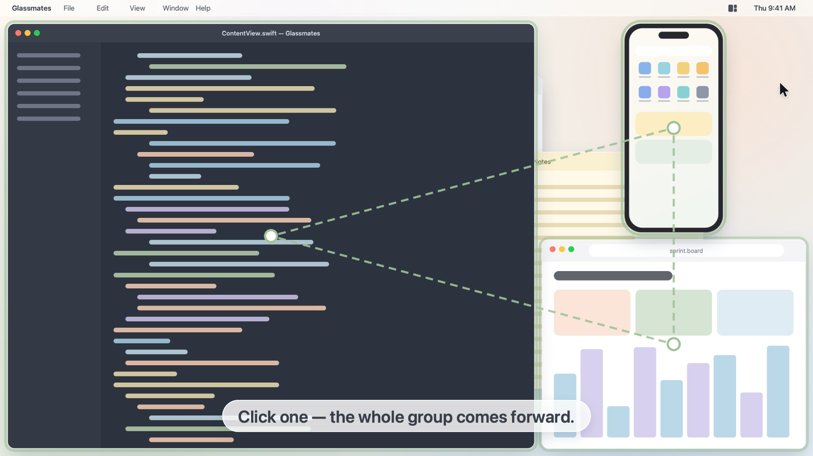
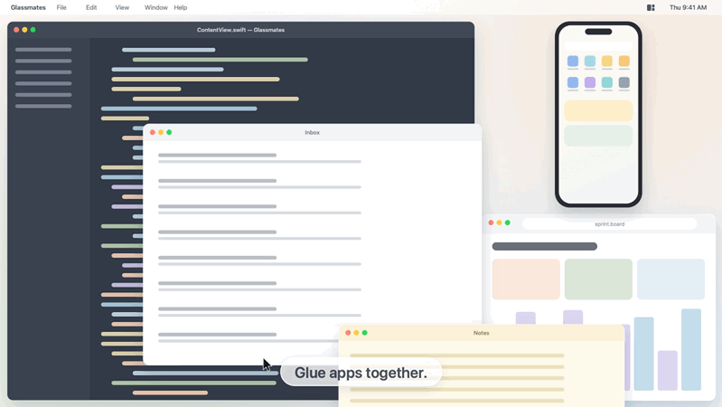
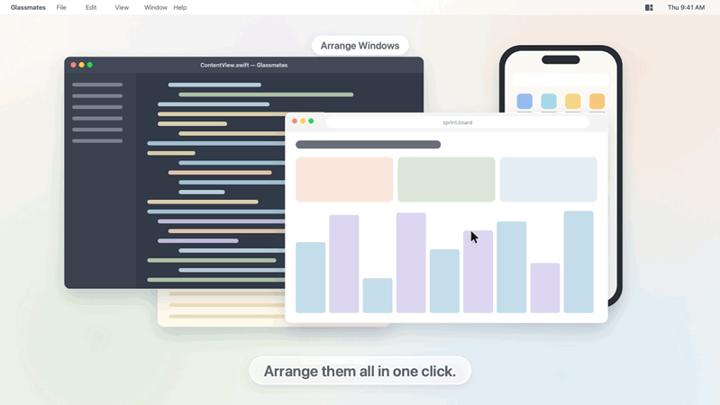
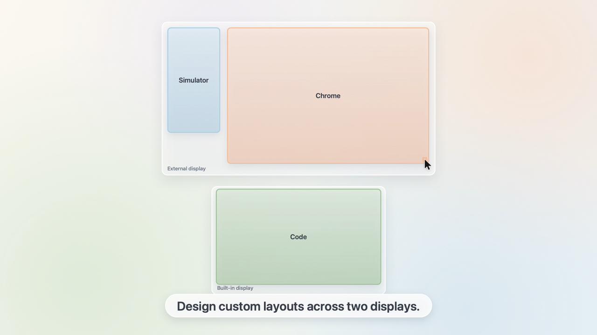
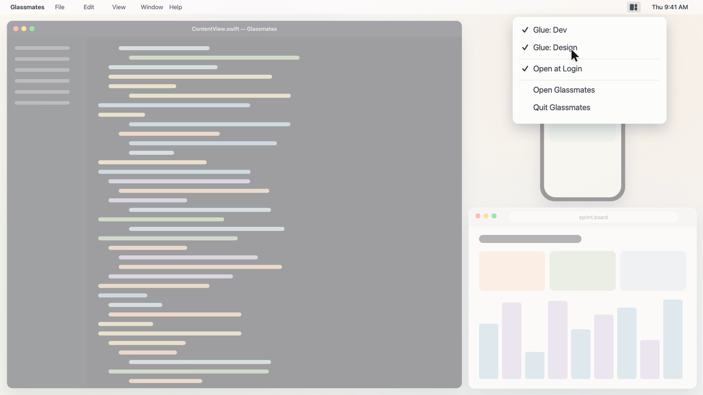

<div align="center">



# Glassmates

**Click one. Bring them all.**

Glue your Mac apps together — when you click one, the whole group comes forward,<br/>
already arranged exactly where you want them. Across one display or two.

[](#requirements)
[](#build-from-source)
[](LICENSE)
[](../../releases/latest)



</div>

---

## Why Glassmates?

You code in an editor, test in the iOS Simulator and read docs in a browser.
Click the editor and the simulator disappears behind something else. Click the
simulator and now the browser is gone. So you click, and click, and click again.

**Glassmates treats those windows as one team.** Put them in a workspace once.
From then on, activating *any* of them — by clicking a window, the Dock or
⌘-Tab — brings the rest forward too, each in its own spot.

## Features

<table>
<tr>
<td width="50%">

### 🧲 Glue apps together
Activate one app in a workspace and the others come forward with it.
The app you clicked keeps focus. Windows that are already visible are left
alone, so there is no flicker.

</td>
<td width="50%"></td>
</tr>
<tr>
<td width="50%"></td>
<td width="50%">

### 🪟 Arrange in one click
Side by side, main 2/3 + side, or grid. Fixed-size windows such as the iOS
Simulator are centered in their slot instead of being stretched.

</td>
</tr>
<tr>
<td width="50%">

### 🖥️ Custom layouts across two displays
Drag and resize each app on a live map of your displays, or capture the
positions your windows are in right now. Each window remembers which display
it belongs to.

</td>
<td width="50%"></td>
</tr>
<tr>
<td width="50%"></td>
<td width="50%">

### 🍃 Lives in your menu bar
Save as many workspaces as you like and toggle glue per workspace.
Glassmates starts at login and keeps working with its window closed.

</td>
</tr>
</table>

**And also**

- ➕ Add or remove apps from a saved workspace at any time
- 🚀 Opening a workspace launches any app that isn't running yet
- 🧹 Optional: minimize an app's *other* windows when they cover the group
  (so clicking Chrome in the Dock doesn't throw every Chrome window on top)
- 🌏 English and Tiếng Việt, following your Mac's language
- 🔒 No network access, no accounts, no analytics — everything stays on your Mac

▶️ **Watch the 30-second demo:** see the `glassmates_promo.mp4` attached to the [latest release](../../releases/latest).

## Install

1. Download **`Glassmates-macOS.zip`** from the [latest release](../../releases/latest) and unzip it.
2. Move **Glassmates.app** to your **Applications** folder.
3. Open it. Because the app isn't notarized by Apple, macOS will block the first launch:
   open **System Settings → Privacy & Security**, scroll down and click **Open Anyway**.
   <br/>Prefer the terminal? `xattr -dr com.apple.quarantine /Applications/Glassmates.app`
4. Grant the two permissions Glassmates asks for (see below), then reopen it.

### Permissions

| Permission | Why it's needed |
|---|---|
| **Accessibility** | To move, resize and raise other apps' windows. This is the core of Glassmates. |
| **Screen & System Audio Recording** | Only to list your open windows by title so you can pick them. No audio is used, and nothing is recorded or saved. |

Both are in **System Settings → Privacy & Security**.

## Quick start

1. Open Glassmates and tick the windows you want to group, in order. The first one is the main window.
2. Pick a layout and click **Arrange Windows** to try it.
3. Click **Save Workspace…** and give it a name. Glue is on by default.
4. Done — click any of those apps and the whole group comes forward.

Want exact positions? In the sidebar, open **Customize Positions…** under your workspace,
drag the frames around both displays, and click **Save**.

## Requirements

- macOS 14 Sonoma or later (developed and tested on macOS 26 Tahoe)
- Apple silicon for the downloadable build (Intel Macs: [build from source](#build-from-source))

## Build from source

You need Xcode 15 or later (Swift 5.9+). Developed with Xcode 26.

```bash
git clone https://github.com/huypq1209/glassmates.git
cd glassmates
./build.sh
open build/Glassmates.app
```

`build.sh` signs with your "Apple Development" certificate if you have one, so macOS
remembers the permissions between builds; otherwise it signs ad-hoc.

<details>
<summary><b>How it works</b></summary>

- **Window control** uses the public Accessibility API (`AXUIElement`) to find each
  app's window and set its position and size.
- **Glue** listens for `NSWorkspace.didActivateApplicationNotification`. When an app in a
  glued workspace becomes active, Glassmates checks the on-screen window order and only
  raises the members that are actually covered.
- **Focus handoff:** in the rare case a member can't be raised without switching focus,
  Glassmates hands focus back to the exact window you clicked using a private SkyLight call
  — the same technique tiling window managers use. If that call is unavailable, it falls back
  to the public API.
- **Window list and previews** use ScreenCaptureKit.
- **Debug log** is off by default. Turn it on with
  `defaults write com.huypham.everythinginone debugLog -bool true`;
  it is written to `~/Library/Logs/Glassmates/debug.log`.

</details>

## Known limitations

- Only windows on the current Space (desktop) can be arranged.
- Some apps limit their own window size; Glassmates centers them in their slot instead.
- The live **Preview** tiles in the main window are view-only. Interacting inside them is an
  experiment that most apps (including the iOS Simulator) ignore.
- Glassmates relies on one private macOS API for focus handoff, so a future macOS update
  could change that behavior. It degrades gracefully instead of breaking.

## Contributing

Issues and pull requests are welcome! If something doesn't arrange the way you expect,
please open an issue with your macOS version, the apps involved and your display setup.

## License

[MIT](LICENSE) © Huy Pham

<div align="center"><sub>Made with care for everyone who juggles too many windows.</sub></div>
